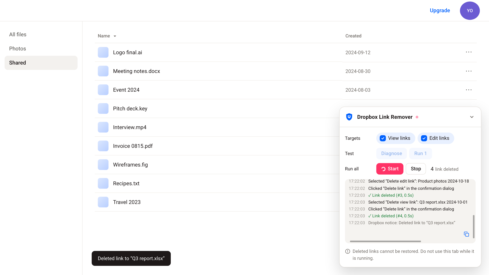

# Dropbox Link Remover

<p align="center"></p>

A Chrome extension that bulk-deletes the shared links on [dropbox.com/share/links](https://www.dropbox.com/share/links). It repeats Dropbox's own steps for each row — "…" menu, "Delete view link" / "Delete edit link", confirm — until no links are left.

> Use at your own risk. Deleted links cannot be restored.

## Installation

1. Open `chrome://extensions` and turn on **Developer mode**
2. Click **Load unpacked** and select this folder

## Usage

Open https://www.dropbox.com/share/links. A panel appears in the bottom-right corner:

- **Targets**: link types to delete (view / edit)
- **Test**: **Diagnose** checks detection without deleting; **Run 1** deletes a single link
- **Run all**: **Start** / **Stop**

Try Diagnose and Run 1 first. During a run, leave the tab alone: scrolling or clicking the page stops it. The copy icon in the log copies the log.

Timings and text patterns are constants at the top of `content.js`.

## Languages

- Dropbox UI: all languages. Menu items and the confirm button are found by Dropbox's class names (checked with 🇯🇵 🇺🇸 🇫🇷 🇨🇳). Outside 🇯🇵 Japanese and 🇺🇸 English, view and edit links cannot be told apart, so keep both Targets checked
- Panel: 🇯🇵 Japanese, 🇺🇸 English, following the Dropbox UI language (others fall back to English). The log is always English

## Testing

Requires Node.js 22+ and Google Chrome.

```sh
node tests/run.mjs          # all tests
node tests/run.mjs safety   # tests whose name contains "safety"
```

The tests run `content.js` against a mock Dropbox page (`tests/fixtures/`) in headless Chrome. Set `CHROME_PATH` if Chrome is not in the default location. `node tools/screenshots.mjs` regenerates the image above.

## License

[MIT](LICENSE). Not affiliated with Dropbox, Inc.
